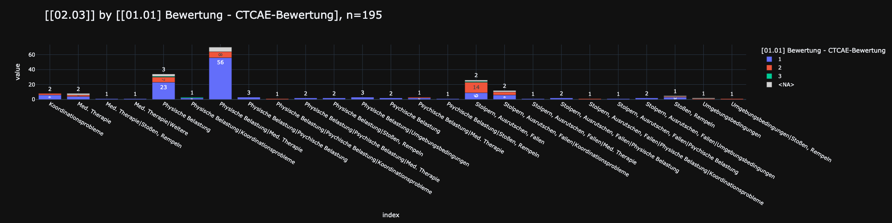

<!-- # sport-adverse-events -->

# Adverse Events in Supervised Pediatric Oncology Exercise: Incidence N=178

<!-- ## sample analysis

 
-->

## 1️⃣ import of raw data

[☁️ data from `REDCap`](./data/in/RegisterZurErfassung_DATA_LABELS_2025-08-11_1552.csv)

## 2️⃣ data transformation

[🐍 python script](./docs/1_create.md)

## 3️⃣ data description

[📈 selected data tables and diagrams](./docs/3_description.md)

## 4️⃣ online analysis

[🌐 streamlit](https://sport-adverse-events-ig9rkc8kxlnqwdswiqm9wy.streamlit.app)
