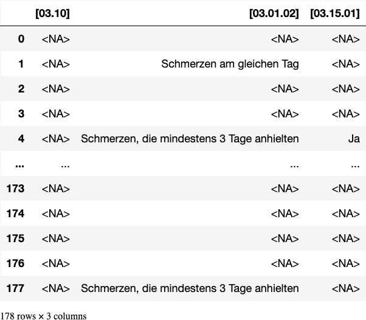
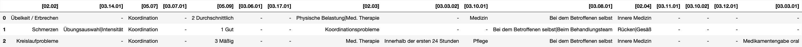
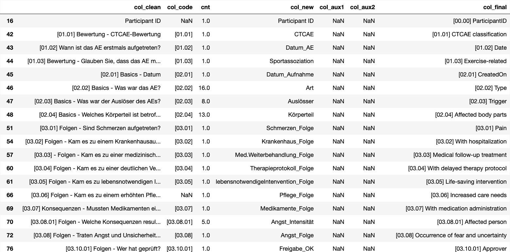
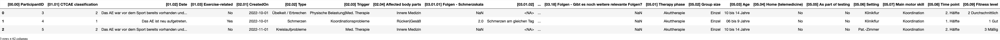
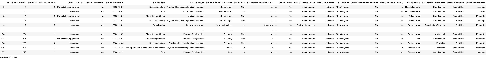
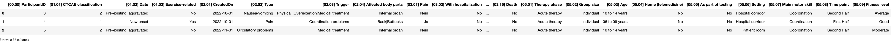

# [create dataset](#toc0_)

**Table of contents**    
- [create dataset](#toc1_)    
  - [init code](#toc1_1_)    
  - [load data](#toc1_2_)    
    - [option clean csv](#toc1_2_1_)    
    - [ (deprecated) option dirty csv](#toc1_2_2_)    
  - [arrange data](#toc1_3_)    
    - [trim column names](#toc1_3_1_)    
    - [set date column](#toc1_3_2_)    
    - [relabeling duplicate columns](#toc1_3_3_)    
    - [remove duplicates or invalids](#toc1_3_4_)    
  - [override columns](#toc1_4_)    
    - [parse dates to datetime 🕥](#toc1_4_1_)    
    - [(deprecated) remove columns w/ no or few values](#toc1_4_2_)    
  - [condensed dataset](#toc1_5_)    
    - [define functions](#toc1_5_1_)    
    - [define single, multi and misc columns](#toc1_5_2_)    
    - [concat condensed dataset from subsets](#toc1_5_3_)    
    - [create manual table for mapping](#toc1_5_4_)    
    - [column mapping from codebook](#toc1_5_5_)    
    - [value mapping for missings and unknown](#toc1_5_6_)    
    - [value mapping from codebook](#toc1_5_7_)    
    - [reduce columns](#toc1_5_8_)    
  - [💾 data for pivot use](#toc1_6_)    

<!-- vscode-jupyter-toc-config
	numbering=false
	anchor=true
	flat=false
	minLevel=1
	maxLevel=6
	/vscode-jupyter-toc-config -->
<!-- THIS CELL WILL BE REPLACED ON TOC UPDATE. DO NOT WRITE YOUR TEXT IN THIS CELL -->

## [init code](#toc0_)

    🐍 3.12.8 | 📦 pygwalker: 0.5.0.0 | 📦 pandas: 2.3.3 | 📦 numpy: 1.26.4 | 📦 duckdb: 1.4.3 | 📦 pandas-plots: 1.1.1 | 📦 connection-helper: 0.13.2

## [load data](#toc0_)

### [option clean csv](#toc0_)

### [ (deprecated) option dirty csv](#toc0_)
- ⚠️ strategy to import the csv raw data:
  - ❌ do not use default `pd.read_csv()`, its not as error tolerant as excel
  - ✅ read csv as `windows-1252` string and cleanse it
    - most (not all) lines have heading + trailing quotes, remove
    - data have a mixture of "" and ", downgrade by 1
    - delimiter "," also occurs in quotes, change to ";" only outside of quotes
    - now byte stream can be imported

## [arrange data](#toc0_)

### [trim column names](#toc0_)

### [set date column](#toc0_)

    [02.01] Basics - Datum

### [relabeling duplicate columns](#toc0_)

### [remove duplicates or invalids](#toc0_)

## [override columns](#toc0_)

### [parse dates to datetime 🕥](#toc0_)

### [(deprecated) remove columns w/ no or few values](#toc0_)

    

    

## [condensed dataset](#toc0_)
- take the cleansed (but structurally unchanged) dataset `df_csv` as a starting point
- define handling for column subsets according to column types
  - **single choice** - only 1 value is allowed per row
  - **multi choice** - multiple values are allowed per row
  - **misc** - all other columns that are selected to appear in the final dataset
- apply column mapping from manual table `codebook_columns.xlsx`
- apply value mapping for missings and unknown value
- apply value mapping from manual table `codebook_values.xlsx`

### [define functions](#toc0_)

### [define single, multi and misc columns](#toc0_)

    ['[03.10] Folgen - Wurde die Situation von einer Person mit entsprechender Expertise direkt geprüft?']
    ['[03.01.02] Folgen - Wie lange dauerten die Schmerzen an? (choice=Schmerzen am gleichen Tag)', '[03.01.02] Folgen - Wie lange dauerten die Schmerzen an? (choice=Schmerzen bis zum Folgetag)', '[03.01.02] Folgen - Wie lange dauerten die Schmerzen an? (choice=Schmerzen, die mindestens 3 Tage anhielten)', '[03.01.02] Folgen - Wie lange dauerten die Schmerzen an? (choice=Weiß nicht)']
    ['[03.15.01] Folgen - War die gesamte Handlungsweise bei diesem AE rein pädagogischer Natur? (choice=Ja)', '[03.15.01] Folgen - War die gesamte Handlungsweise bei diesem AE rein pädagogischer Natur? (choice=Nein)']

    

    

    

    

### [concat condensed dataset from subsets](#toc0_)

    

    

### [create manual table for mapping](#toc0_)

### [column mapping from codebook](#toc0_)
- in `codebook_columns.xlsx`
  - col names in `col_clean` (full label) -> `col_final`
  - col names in `col_code` (code only) -> `col_new`

    

    

    {'[00.00] ParticipantID': '[00.00] ParticipantID',
     '[01.01] Bewertung - CTCAE-Bewertung': '[01.01] CTCAE classification',
     '[01.02] Wann ist das AE erstmals aufgetreten?': '[01.02] Date',
     '[01.03] Bewertung - Glauben Sie, dass das AE mit dem Sport assoziiert ist?': '[01.03] Exercise-related',
     '[02.01] Basics - Datum': '[02.01] CreatedOn',
     '[02.02]': '[02.02] Type',
     '[02.03]': '[02.03] Trigger',
     '[02.04]': '[02.04] Affected body parts',
     '[03.01] Folgen - Sind Schmerzen aufgetreten?': '[03.01] Pain',
     "[03.02] Folgen - Kam es zu einem Krankenhausaufenthalt oder zu einer Verlängerung dieses Aufenthalts?'": '[03.02] With hospitalization',
     '[03.03] - Folgen - Kam es zu einer medizinischen Weiterbehandlung?': '[03.03] Medical follow-up treatment',
     "[03.04] Folgen -Kam es zu einer deutlichen Verzögerung bei der Umsetzung des medizinischen Therapieprotokolls?'": '[03.04] With delayed therapy protocol',
     '[03.05] Folgen - Kam es zu lebensrettenden Interventionen (z.\u202fB. Beatmung, Herzdruckmassage)?': '[03.05] Life-saving intervention',
     '[03.06] Folgen - Gab es einen erhöhten Pflegebedarf?': '[03.06] Increased care needs',
     '[03.07] Konsequenzen - Mussten Medikamente eingenommen werden?': '[03.07] With medication administration',
     '[03.08.01]': '[03.08.01] Affected person',
     '[03.08] Folgen - Kam es zu Angst und Unsicherheit?': '[03.08] Occurrence of fear and uncertainty',
     '[03.10.01]': '[03.10.01] Approver',
     '[03.10.02]': '[03.10.02] OK to proceed',
     '[03.10]': '[03.10] Assessment of the situation by expertise',
     '[03.11] Folgen - Wurde die PECH-Regel zur Behandlung angewendet?': '[03.11] Application RICE rule (Rest, Ice, Compression, Elevation)',
     '[03.12] Folgen - Wurde das Kind nach dem AE observiert?': '[03.12] With observation',
     '[03.13.01] Folgen - Wie wurde gestoppt?': '[03.13.01] Temporary suspension of session',
     '[03.13] Folgen - Wurde die Bewegungseinheit gestoppt?': '[03.13] Suspension and termination of session',
     '[03.14.01]': '[03.14.01] Adaptations intensity',
     '[03.14] Folgen - Wurde die Bewegungseinheit inhaltlich verändert oder angepasst?': '[03.14] Adaptation',
     '[03.16] Folgen - Kam es zum Tod?': '[03.16] Death',
     '[05.01] Rahmenbedingung - In welcher Phase der Therapie trat das AE auf?': '[05.01] Therapy phase',
     '[05.02] Rahmenbedingungen - In welcher Gruppengröße fand die Sporteinheit statt, in der das AE auftrat?': '[05.02] Group size',
     '[05.03] Rahmenbedingungen - Wie alt war der/die Betroffene zum Zeitpunkt des AE?': '[05.03] Age',
     '[05.04] Rahmenbedingungen - Fand das Sportprogramm online statt?': '[05.04] Home (telemedicine)',
     '[05.05] Rahmenbedingungen - Fand das AE im Rahmen einer Sporttestung statt?': '[05.05] As part of testing',
     '[05.06] Rahmenbedingungen - In welchem Setting trat das AE auf?': '[05.06] Setting',
     '[05.07]': '[05.07] Main motor skill',
     '[05.08] Rahmenbedingungen - In welcher Phase der geplanten Sporteinheit trat das AE auf?': '[05.08] Time point',
     '[05.09]': '[05.09] Fitness level'}

    

    

### [value mapping for missings and unknown](#toc0_)

    in [02.04] Affected body parts: - -> <NA>
    in [03.02] With hospitalization: weiß nicht -> (Unknown)
    in [03.03] Medical follow-up treatment: weiß nicht -> (Unknown)
    in [03.07] With medication administration: weiß nicht -> (Unknown)
    in [03.12] With observation: Weiß nicht -> (Unknown)
    in [03.14.01] Adaptations intensity: - -> <NA>
    in [03.17] Folgen - Kam es zu Einschränkungen der Aktivitäten des täglichen Lebens (ADL)?: weiß nicht -> (Unknown)
    in [05.03] Age: weiß nicht -> (Unknown)
    in [05.07] Main motor skill: - -> <NA>
    in [05.09] Fitness level: - -> <NA>
    in [05.09] Fitness level: weiß nicht -> (Unknown)
    in [03.08.01] Affected person: - -> <NA>

### [value mapping from codebook](#toc0_)
- in `codebook_values.xlsx`
  - col codes in `code`
  - old value in `de` -> new value in `en`

### [reduce columns](#toc0_)

    

    

    Index(['[00.00] ParticipantID', '[01.01] CTCAE classification', '[01.02] Date',
           '[01.03] Exercise-related', '[02.01] CreatedOn', '[02.02] Type',
           '[02.03] Trigger', '[02.04] Affected body parts', '[03.01] Pain',
           '[03.02] With hospitalization', '[03.03] Medical follow-up treatment',
           '[03.04] With delayed therapy protocol',
           '[03.05] Life-saving intervention', '[03.06] Increased care needs',
           '[03.07] With medication administration', '[03.08.01] Affected person',
           '[03.08] Occurrence of fear and uncertainty', '[03.10.01] Approver',
           '[03.10.02] OK to proceed',
           '[03.10] Assessment of the situation by expertise',
           '[03.11] Application RICE rule (Rest, Ice, Compression, Elevation)',
           '[03.12] With observation',
           '[03.13.01] Temporary suspension of session',
           '[03.13] Suspension and termination of session',
           '[03.14.01] Adaptations intensity', '[03.14] Adaptation',
           '[03.16] Death', '[05.01] Therapy phase', '[05.02] Group size',
           '[05.03] Age', '[05.04] Home (telemedicine)',
           '[05.05] As part of testing', '[05.06] Setting',
           '[05.07] Main motor skill', '[05.08] Time point',
           '[05.09] Fitness level'],
          dtype='object')

## [💾 data for pivot use](#toc0_)

    🔵 *** df: df_csv_condensed ***  
    🟣 shape: (178, 36)
    🟣 duplicates: 0 (0%)  
    🟠 column stats all (dtype | uniques | missings) [values]  
    - index [0, 1, 2, 3, 4,]  
    - [00.00] ParticipantID (int64 | 178 | 0 (0%)) [3, 4, 5, 6, 7,]  
    - [01.01] CTCAE classification (object | 3 | 0 (0%)) ['1', '2', '3',]  
    - [01.02] Date (object | 2 | 0 (0%)) ['New onset', 'Pre-existing, aggravated',]  
    - [01.03] Exercise-related (object | 3 | 0 (0%)) ['No', 'Yes', 'nan',]  
    - [02.01] CreatedOn (datetime64[ns] | 127 | 0 (0%)) [2021-01-11 00:00:00, 2021-01-12 00:00:00, 2021-01-18 00:00:00, 2021-02-01 00:00:00,  
    2021-02-19 00:00:00,]  
    - [02.02] Type (object | 32 | 0 (0%)) ['Bone injuries', 'Circulatory problems', 'Circulatory problems|Muscle cramps',  
    'Circulatory problems|Physical (Over)exertion', 'Circulatory problems|Psychological stress reaction',]  
    - [02.03] Trigger (object | 24 | 0 (0%)) ['Collision', 'Coordination problems', 'Environmental conditions|Collision',  
    'Fall-related incident', 'Fall-related incident|Coordination problems',]  
    - [02.04] Affected body parts (object | 21 | 0 (0%)) ['<NA>', 'Abdomen', 'Abdomen|Bowel', 'Abdomen|Coccyx', 'Back',]  
    - [03.01] Pain (object | 2 | 0 (0%)) ['Ja', 'Nein',]  
    - [03.02] With hospitalization (object | 3 | 0 (0%)) ['(Unknown)', 'No', 'Yes',]  
    - [03.03] Medical follow-up treatment (object | 3 | 0 (0%)) ['(Unknown)', 'No', 'Yes',]  
    - [03.04] With delayed therapy protocol (object | 1 | 0 (0%)) ['No',]  
    - [03.05] Life-saving intervention (object | 1 | 0 (0%)) ['No',]  
    - [03.06] Increased care needs (object | 2 | 0 (0%)) ['No', 'Yes',]  
    - [03.07] With medication administration (object | 4 | 5 (3%)) ['(Unknown)', '<NA>', 'No', 'Yes',]  
    - [03.08.01] Affected person (object | 8 | 0 (0%)) ['<NA>', 'For affected individuals', 'For affected individuals|For parents',  
    'For affected individuals|For parents|In the treatment team', 'For affected individuals|For the excercise experts',]  
    - [03.08] Occurrence of fear and uncertainty (object | 3 | 0 (0%)) ['No', 'Yes', 'nan',]  
    - [03.10.01] Approver (object | 6 | 0 (0%)) ['-', 'Medical team', 'Nursing team', 'Parents', 'Physiotherapy',]  
    - [03.10.02] OK to proceed (object | 1 | 0 (0%)) ['-',]  
    - [03.10] Assessment of the situation by expertise (object | 1 | 178 (100%)) ['<NA>',]  
    - [03.11] Application RICE rule (Rest, Ice, Compression, Elevation) (object | 2 | 0 (0%)) ['No', 'Yes',]  
    - [03.12] With observation (object | 3 | 0 (0%)) ['(Unknown)', 'No', 'Yes',]  
    - [03.13.01] Temporary suspension of session (object | 3 | 0 (0%)) ['Suspension of session', 'Termination of session', 'nan',]  
    - [03.13] Suspension and termination of session (object | 2 | 0 (0%)) ['No', 'Yes',]  
    - [03.14.01] Adaptations intensity (object | 9 | 0 (0%)) ['<NA>', 'Communication strategy', 'Equipment', 'Exercise selection', 'Exercise selection|Equipment',]  
    - [03.14] Adaptation (object | 2 | 0 (0%)) ['No', 'Yes',]  
    - [03.16] Death (object | 1 | 0 (0%)) ['No',]  
    - [05.01] Therapy phase (object | 3 | 0 (0%)) ['Acute therapy', 'Long-term therapy', 'Post-treatment care',]  
    - [05.02] Group size (object | 5 | 0 (0%)) ['Group 2-5', 'Group 5 to 10', 'Group over 10', 'Individual', 'nan',]  
    - [05.03] Age (object | 6 | 0 (0%)) ['02 to 05 years', '06 to 09 years', '10 to 14 years', '15 to 18 years', '18+ years',]  
    - [05.04] Home (telemedicine) (object | 3 | 1 (1%)) ['<NA>', 'No', 'Yes',]  
    - [05.05] As part of testing (object | 3 | 0 (0%)) ['No', 'Yes', 'nan',]  
    - [05.06] Setting (object | 6 | 0 (0%)) ['At home (via telemedicine)', 'Exercise room', 'Hospital corridor', 'Outdoors',  
    'Patient room',]  
    - [05.07] Main motor skill (object | 16 | 0 (0%)) ['<NA>', 'Coordination', 'Coordination|Speed', 'Coordination|Strength', 'Endurance',]  
    - [05.08] Time point (object | 3 | 0 (0%)) ['First Half', 'Second Half', 'nan',]  
    - [05.09] Fitness level (object | 5 | 0 (0%)) ['(Unknown)', '<NA>', 'Average', 'Good', 'Moderate',]  
    
    🟠 column stats numeric  
    
    column (n = 178)      |  present   | min | lower |  q25   | median  |  mean   |   q75   | upper | max |  std   |  cv  
    ----------------------+------------+-----+-------+--------+---------+---------+---------+-------+-----+--------+------
    [00.00] ParticipantID | 178 (100%) |   3 |     3 | 51.250 | 111.500 | 105.500 | 156.750 |   213 | 213 | 60.527 | 0.574
    

    

    

